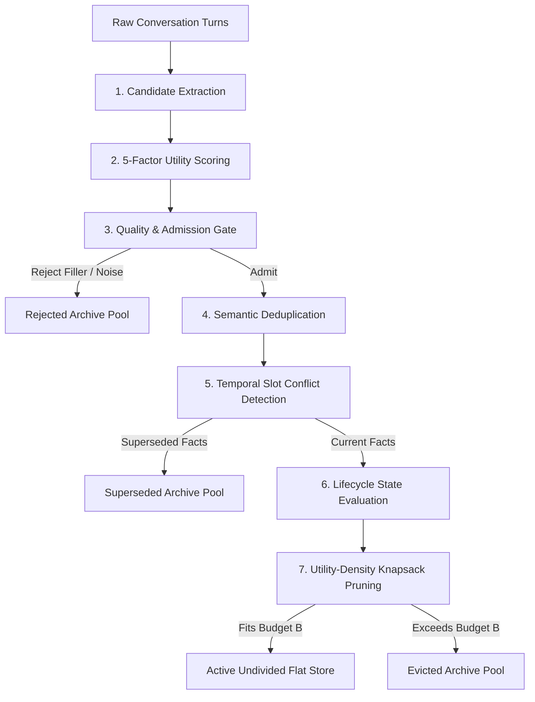

# Teammate A — Flat Memory Strategy (`team_flat`) Documentation

This document explains the architecture, mathematical formulations, implementation details, parameter configurations, and verification commands for **Teammate A's Flat Memory Strategy (`team_flat`)**.

---

## 1. What is Flat Memory?

In the Adaptive Long-Term Memory research architecture, memory strategies are evaluated under a strictly bounded persistent token budget $B$ (e.g., $B = 50$, $150$, or $500$ tokens).

Unlike **Hierarchical Strategies** which split storage into fixed or adaptive partitions (e.g., $70\%$ episodic / $30\%$ semantic):
- **Flat Memory** stores all admissible facts in a **single, undivided pool**.
- There are **no separate quotas** or silos for episodic events versus semantic knowledge.
- Storage pruning operates across the entire pool based strictly on **utility-density**.

---

## 2. Architecture & Pipeline Stages

The `TeamFlatMemoryStrategy` is implemented in [`strategies/flat_team.py`](file:///c:/Users/jabba/Adaptive_longterm_memory_with_SLM/strategies/flat_team.py) and registered as `"team_flat"`.

When conversation turns arrive via `process_session()`, they undergo an 8-stage lifecycle:



### Stage 1: Candidate Extraction
- Uses `HeuristicCandidateExtractor` (or `SLMCandidateExtractor`) to break compound sentences into atomic propositions.
- Suppresses conversation pleasantries ("thanks", "cool", "hello").
- Identifies temporal anchors ("used to work at", "moved in 2023").

### Stage 2: Mathematical Utility Scoring Formula
Every candidate memory $m$ is evaluated with an aggregated utility score $U(m) \in [0.0, 1.0]$:

$$U(m) = w_r \cdot R(m) + w_i \cdot I(m) + w_f \cdot F_{\text{norm}}(m) + w_t \cdot T(m) + w_c \cdot C(m)$$

#### Default Parameter Weights ($\sum w = 1.0$):
| Weight | Parameter | Value | Definition & Role |
| :--- | :--- | :--- | :--- |
| $w_r$ | **Recency** ($R$) | `0.25` | Exponential time decay: $R(m) = e^{-\lambda \cdot \Delta t}$, rewarding recently observed facts. |
| $w_i$ | **Importance** ($I$) | `0.25` | Intrinsic significance of the fact slot (e.g., employer, city = `0.85`, transient tasks = `0.40`). |
| $w_f$ | **Frequency** ($F_{\text{norm}}$) | `0.20` | Repetition factor: $F_{\text{norm}} = \min(1.0, \frac{\log(1 + f)}{\log(1 + 5)})$, rewarding reinforced facts. |
| $w_t$ | **Temporal Stability** ($T$) | `0.15` | Resistance to change (durable profile facts = `0.90`, temporary debugging requests = `0.20`). |
| $w_c$ | **Consistency Confidence** ($C$) | `0.15` | Confidence metric discounted by hedging phrases ("maybe", "I think"). |

### Stage 3: Quality & Admission Gating
- **Informativeness Gate**: Discards single-word responses and pleasantry patterns.
- **Confidence Gate**: Drops candidates with $C(m) < 0.30$.
- **Importance Gate**: Drops candidates with $I(m) < 0.20$.

### Stage 4: Semantic Deduplication
- Calculates lexical Jaccard overlap and Gestalt sequence similarity against existing pool memories.
- If match $\ge 0.80$, merges provenance and increments frequency $f$ rather than duplicating token storage.

### Stage 5: Temporal Slot Conflict Resolution & Superseding
- Identifies entity-attribute slots (e.g., `residence_city`, `employer`, `editor_preference`).
- When an updated fact arrives (e.g., "I work at Google" updating "I work at OpenAI"):
  - Older fact transitions to `SUPERSEDED` status and is moved to the archive store.
  - New fact records historical predecessor link (`predecessor_ids`).
  - **Zero Stale Error**: Prevents contradictory old facts from polluting active retrieval context.

### Stage 6: Knapsack Budget Pruning (Utility-Density)
When total tokens exceed budget $B$, items are selected by maximizing total utility under the token weight constraint (0/1 Knapsack density heuristic):

$$\text{Density}(m) = \frac{U(m)}{\text{token\_cost}(m)}$$

- High-utility, concise facts are prioritized.
- Low-utility or verbose items exceeding budget $B$ are evicted to the archive pool.

### Stage 7: Query Retrieval
- For current-state queries, only `ACTIVE` and `STABLE` items in the flat pool are searched.
- For historical queries ("Where did I work previously?"), predecessor links trace past facts.
- Normalized score:

$$\text{Relevance}(q, m) = 0.5 \cdot \text{LexicalOverlap}(q, m) + 0.3 \cdot \text{SlotMatch}(q, m) + 0.2 \cdot U(m)$$

---

## 3. Files Created & Modified

| File | Type | Purpose |
| :--- | :--- | :--- |
| [`strategies/flat_team.py`](file:///c:/Users/jabba/Adaptive_longterm_memory_with_SLM/strategies/flat_team.py) | **New** | Complete Teammate A flat memory strategy subclassing `BaseMemoryStrategy` and registered as `@register_strategy("team_flat")`. |
| [`test_team_flat.py`](file:///c:/Users/jabba/Adaptive_longterm_memory_with_SLM/test_team_flat.py) | **New** | 5 targeted unit tests covering auto-discovery, intake, superseding, budget cap, and reset isolation. |
| [`test_shared_pipeline.py`](file:///c:/Users/jabba/Adaptive_longterm_memory_with_SLM/test_shared_pipeline.py) | **Bugfix** | Corrected dataset loading assertion for `longmemeval_dev` split. |

---

## 4. Terminal Commands to Show Live Proof to Teammates

Here are the step-by-step terminal commands to reproduce and demonstrate everything live:

### 1. Show Strategy Registration (Auto-Discovery)
Demonstrates that the shared harness automatically discovers `team_flat` from the `strategies/` directory without altering shared runner code:

```powershell
python run_experiments.py --list-strategies
```
> **Expected Output:** `team_flat` appears in the list of registered strategies.

---

### 2. Run Live Single Benchmark Question (Synthetic Fact Retrieval)
Runs question 1 (`synth_01_stable_fact`) with a 500-token budget:

```powershell
python run_experiments.py --strategy team_flat --dataset synthetic --budgets 500 --limit 1
```
> **Expected Output:**
> - `Accuracy: 100.0%`
> - `Recall@K: 100.0%`
> - `MRR: 1.000`
> - `Stale Error: 0.0%`
> - `Storage Used: ~7.0 tokens`

---

### 3. Run Budget Stress Test Across 50, 150, and 500 Tokens
Demonstrates that flat memory stays strictly bounded to the allocated token budgets across all 8 synthetic scenarios:

```powershell
python run_experiments.py --strategy team_flat --dataset synthetic --budgets 50 150 500
```
> **Expected Output:** Complete research evaluation table comparing accuracy, token F1, recall, and storage usage across budgets.

---

### 4. Run Strategy Dedicated Unit Test Suite
Proves candidate filtering, conflict superseding, budget pruning, and cross-question isolation:

```powershell
python -m unittest test_team_flat.py -v
```
> **Expected Output:**
> ```
> test_auto_discovery_and_registration ... ok
> test_budget_enforcement ... ok
> test_conflict_superseding ... ok
> test_intake_and_retrieval ... ok
> test_reset_isolation ... ok
> ----------------------------------------------------------------------
> Ran 5 tests in 0.008s -> OK
> ```

---

### 5. Run Entire Repository Verification Suite (100 Tests)
Demonstrates that all core engine, lifecycle, retrieval, evaluation, and teammate tests pass without breaking changes:

```powershell
python -m unittest discover -v -s . -p "test_*.py"
```
> **Expected Output:**
> ```
> Ran 100 tests in 0.176s -> OK
> ```
